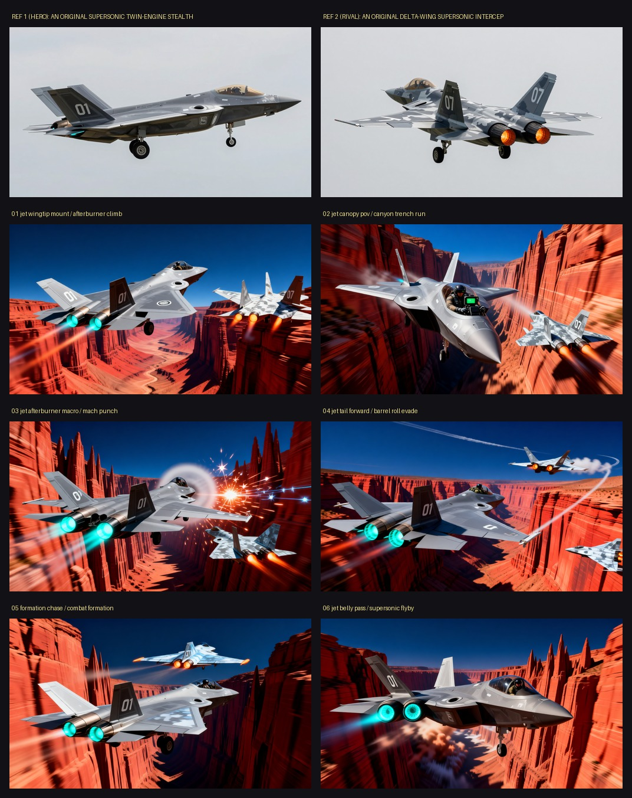
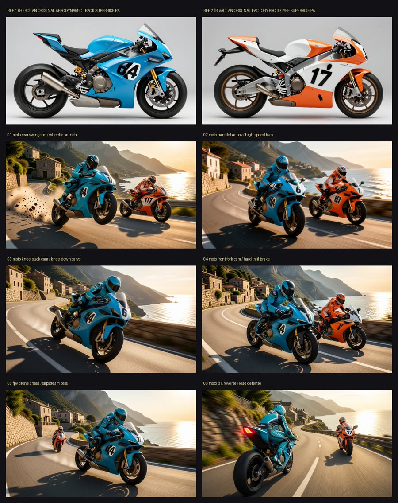
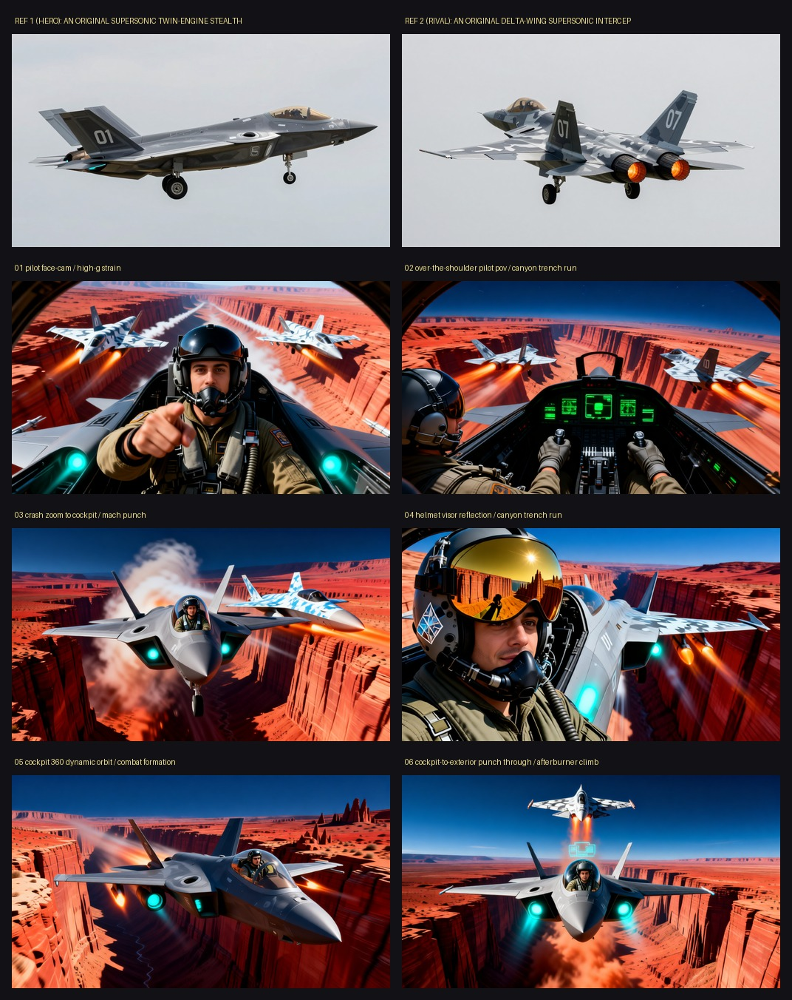

# Velocity Rig

**Camera-rig simulation for high-speed vehicle shots: pick a subject, a world and one of 45 mounts and lenses, and get a hard-cut reel with engine sound, on open weights end to end.**


*First 7 s of a 6-shot jet canyon reel, rendered entirely on open weights in one ComfyUI prompt. The plates below are its first frames: two Z-Image vehicle refs (top), then one Qwen Image Edit plate per camera rig.*



Open weights only: Z-Image Turbo draws the vehicles, Qwen Image Edit 2511 keeps every plate on the same design, LTX-2.5 22B distilled animates it with synchronized audio.
There is no closed-model backend anywhere in this repository (no hosted image API, no partner node), and no shipped workflow references one.

## What it rebuilds from Higgsfield

Higgsfield's draw is cinematography presets: FPV and drone moves, vehicle-mounted cameras, crash zooms, speed ramps. Velocity Rig rebuilds that as open ComfyUI nodes and a library you can read:

- **45 camera rigs** in three families (vehicle-mounted, chase/aerial, trackside), each with its lens, its motion wording, its default action and its FX recipe.
- **6 subjects** (cars, GP superbikes, fighter jets, jet pilot POV, downhill MTB, speedboats), **6 visual styles**, **16 worlds**, 9 lights, 35 action beats and 3 aspect ratios.
- **A race sequence**: `auto (race sequence)` walks a curated arc (launch, bumper draft, hard brake, wheel-cam hairpin, FPV drift, door-mount overtake, reverse bumper defense, whip-pan finish) and switches rig every shot.
- **Mount physics as post FX** (`VelocityFX`): rig shake, radial speed blur that keeps the vehicle sharp, zoom punch, chroma fringing, speed ramp. The frame count never changes, so the LTX audio stays in sync.
- **Identity lock**: Z-Image draws a hero and a rival once, or you upload your own vehicle and a pilot selfie; Qwen Image Edit then renders every plate from those refs.

## What you can pick

- **6 vehicle types**: car, GP superbike, fighter jet, jet pilot POV (your selfie in the cockpit), downhill MTB, speedboat. The vehicle itself is free text or your photo.
- **45 camera rigs** (wheel, door, bumper, roof, exhaust, underbody, cockpit, mirror, FPV dive and chase, helicopter, roadside whip pan, crash zoom, and bike, jet and boat mounts), plus **Velocity Rig Builder**: 19 mount anchors x 5 pitches x 7 lenses x 4 stabilizers (about 2,600 custom rigs).
- **16 worlds** or your own text, **9 lights**, **35 actions** (drift, overtake, near miss, jump, barrel roll, wave skip...), **6 visual styles**, 16:9 / 9:16 / 2.35:1.

## Nodes

| Node | What it does |
|---|---|
| `VelocityRig` | subject + style + vehicles + world + rig + action + light -> first-frame prompt, LTX motion prompt, negatives, sizes, frames, seed, FX defaults |
| `VelocityRigBuilder` | the same from your own mount anchor, camera pitch, lens profile and mount stability |
| `VelocityFX` | shake, speed blur, zoom punch, chroma, ramp on the decoded frames; sliders override the rig's defaults |
| `VelocityReel` | hard-cuts the last N saved shots into one reel, trims LTX's wake-up frames, keeps the audio |
| `VelocityRigList` | the whole rig / world / action library as text |

## Workflows (`workflows/`, UI and `_api` JSON)

| Workflow | Graph | Model files it loads |
|---|---|---|
| `velocity_rig_shot` | Velocity Rig -> Z-Image Turbo first frame -> LTX-2.5 image-to-video + audio -> Velocity FX | ae, gemma4-12b-with-proj-ltx-2.5-bf16, ltx-2.5-22b-distilled-transformer-bf16, ltx-2.5-audio-vae-bf16, ltx-2.5-latent-spatial-upscaler-x2-bf16-1.0, ltx-2.5-video-vae-bf16, qwen_3_4b, z_image_turbo_bf16 |
| `velocity_rig_photo` | your vehicle photo -> Qwen Image Edit 2511 (+ Lightning LoRA) puts it into the rig's framing -> LTX-2.5 -> FX | Qwen-Image-Edit-2511-Lightning-4steps-V1.0-bf16, gemma4-12b-with-proj-ltx-2.5-bf16, ltx-2.5-22b-distilled-transformer-bf16, ltx-2.5-audio-vae-bf16, ltx-2.5-latent-spatial-upscaler-x2-bf16-1.0, ltx-2.5-video-vae-bf16, qwen_2.5_vl_7b, qwen_image_edit_2511_bf16, qwen_image_vae |
| `velocity_rig_race` | hero + rival reference images -> Qwen Image Edit -> LTX-2.5 -> FX | Qwen-Image-Edit-2511-Lightning-4steps-V1.0-bf16, gemma4-12b-with-proj-ltx-2.5-bf16, ltx-2.5-22b-distilled-transformer-bf16, ltx-2.5-audio-vae-bf16, ltx-2.5-latent-spatial-upscaler-x2-bf16-1.0, ltx-2.5-video-vae-bf16, qwen_2.5_vl_7b, qwen_image_edit_2511_bf16, qwen_image_vae |
| `velocity_rig_builder` | the race graph driven by Velocity Rig Builder (custom mount and lens) | Qwen-Image-Edit-2511-Lightning-4steps-V1.0-bf16, gemma4-12b-with-proj-ltx-2.5-bf16, ltx-2.5-22b-distilled-transformer-bf16, ltx-2.5-audio-vae-bf16, ltx-2.5-latent-spatial-upscaler-x2-bf16-1.0, ltx-2.5-video-vae-bf16, qwen_2.5_vl_7b, qwen_image_edit_2511_bf16, qwen_image_vae |
| `velocity_rig_reel` | Velocity Reel: stitch the last N saved shots (no model) | none |

Shot workflows render one shot per run. Set `shot_index` to *increment* and queue 6-8 runs for a full race arc, then run the reel workflow.

## Models

| File | Folder | What | Download | License |
|---|---|---|---|---|
| `ltx-2.5-22b-distilled-transformer-bf16.safetensors` | `models/diffusion_models/` | LTX-2.5 22B distilled video+audio transformer | [source](https://huggingface.co/Lightricks/LTX-2.5) | LTX-2.5 license (Lightricks); read the model card |
| `ltx-2.5-video-vae-bf16.safetensors` | `models/vae/` | LTX-2.5 video VAE | [source](https://huggingface.co/Lightricks/LTX-2.5/resolve/main/vae/ltx-2.5-video-vae-bf16.safetensors) | LTX-2.5 license |
| `ltx-2.5-audio-vae-bf16.safetensors` | `models/vae/` | LTX-2.5 audio VAE | [source](https://huggingface.co/Lightricks/LTX-2.5/resolve/main/vae/ltx-2.5-audio-vae-bf16.safetensors) | LTX-2.5 license |
| `ltx-2.5-latent-spatial-upscaler-x2-bf16-1.0.safetensors` | `models/latent_upscale_models/` | LTX-2.5 x2 spatial latent upscaler | [source](https://huggingface.co/Lightricks/LTX-2.5/resolve/main/latent_upscale_models/ltx-2.5-latent-spatial-upscaler-x2-bf16-1.0.safetensors) | LTX-2.5 license |
| `gemma4-12b-with-proj-ltx-2.5-bf16.safetensors` | `models/text_encoders/` | Gemma text encoder with LTX projection | [source](https://huggingface.co/Lightricks/LTX-2.5) | Gemma Terms of Use + LTX-2.5 license |
| `z_image_turbo_bf16.safetensors` | `models/diffusion_models/` | Z-Image Turbo (fast stills, 8 steps) | [source](https://huggingface.co/Comfy-Org/z_image_turbo) | Apache-2.0 (check card) |
| `qwen_3_4b.safetensors` | `models/text_encoders/` | Qwen3 4B text encoder for Z-Image | [source](https://huggingface.co/Comfy-Org/z_image_turbo) | Apache-2.0 (check card) |
| `ae.safetensors` | `models/vae/` | Z-Image VAE | [source](https://huggingface.co/Comfy-Org/z_image_turbo) | check card |
| `qwen_image_edit_2511_bf16.safetensors` | `models/diffusion_models/` | Qwen Image Edit 2511 (multi-reference edit) | [source](https://huggingface.co/Comfy-Org/Qwen-Image-Edit_ComfyUI) | Apache-2.0 (check card) |
| `qwen_2.5_vl_7b.safetensors` | `models/text_encoders/` | Qwen2.5-VL 7B text encoder for Qwen Image Edit | [source](https://huggingface.co/Comfy-Org/HunyuanImage_2.1_ComfyUI) | Apache-2.0 (check card) |
| `qwen_image_vae.safetensors` | `models/vae/` | Qwen Image VAE | [source](https://huggingface.co/Comfy-Org/Qwen-Image_ComfyUI) | Apache-2.0 (check card) |
| `Qwen-Image-Edit-2511-Lightning-4steps-V1.0-bf16.safetensors` | `models/loras/` | Lightning 4-step LoRA for Qwen Image Edit 2511 | [source](https://huggingface.co/lightx2v/Qwen-Image-Edit-2511-Lightning) | check card |

No weights are shipped here. Licenses are as we read the model cards on 2026-10-28; check each card before you redistribute anything. File names must match exactly because the loader nodes in the workflows name them; the download pages hold the same files or the closest published variant, so rename if a page ships another precision.

## Install

Needs Python 3.11+, [uv](https://docs.astral.sh/uv/), ffmpeg on PATH, and a ComfyUI that has the models below (ComfyUI 0.35 or newer).

```bash
git clone https://github.com/jk-automations/velocity-rig && cd velocity-rig

# 1. the ComfyUI custom nodes: symlink the pack into ComfyUI and restart it
ln -s "$PWD/custom_nodes/comfyui-velocity-rig" ~/ComfyUI/custom_nodes/comfyui-velocity-rig

# 2. the runner + web app
uv venv && uv pip install -e ".[proxy]"      # .[proxy] adds comfy-api-proxy; plain -e . if you already run one
```

The nodes need only torch, numpy and Pillow, which ComfyUI already has. The runner and the app talk to ComfyUI through the Comfy SDK, which speaks Comfy API v2,
so start the API v2 proxy in front of your ComfyUI (what `ops/serve.sh` does; it supervises both processes):

```bash
COMFYUI_DIR=~/ComfyUI ops/serve.sh start     # ComfyUI on :8198, comfy-api-proxy on :8195
export COMFY_BASE_URL=http://127.0.0.1:8195  # the default; Comfy Cloud or a serverless URL works the same way
ops/serve.sh status
```

Put the model files from the table above into `ComfyUI/models/<folder>/`. A first run needs the LTX set plus either the Z-Image set (`velocity_rig_shot`) or the Qwen set (every other workflow and the runner).

## Web app

```bash
.venv/bin/python app/server.py --port 8811            # http://127.0.0.1:8811
.venv/bin/python app/server.py --port 8811 --dry-run  # same UI, placeholder outputs, never contacts ComfyUI
```

One page: the controls (their choices are read from the pack's library), uploads, a Render button that runs the runner as a background job, live progress over SSE
(stage, ComfyUI node and sampler step), the **executed ComfyUI graph** of every submit read from the saved `*.graph.json` files (click a node for its inputs, download the
API JSON to open it in ComfyUI), and a gallery of every run under `runs/`, including runs started from the command line. The stack panel names the models and nodes behind each stage.

**Replay mode** (`--replay-from <finished run dir>`): every Render copies that finished run (refs, plates, clips, `shots.json`, `*.graph.json`) into the new job and runs the real runner on the cache, with the same arguments. It finishes in seconds, shows the real plates, the real executed graphs and the real reel, and submits nothing: `RIG_REPLAY=1` makes the Comfy layer refuse to submit, so a missing cached file aborts the job instead of rendering. The app shows a "replaying a finished render" badge. Used for demo recordings.

```bash
.venv/bin/python app/server.py --port 8811 --replay-from runs/velocity-rig/jet-canyon-open
```

## Command line

```bash
# six-shot mountain race, hero and rival drawn by Z-Image, plates by Qwen Image Edit, video by LTX-2.5
.venv/bin/python -m velocityrig --world "mountain pass" --shots 6 --seed 7 --out runs/velocity-rig/race1

# your own vehicle, a jet, stills only (about a minute per plate), then continue later: finished plates and clips are cached
.venv/bin/python -m velocityrig --photo my_car.png --shots 4 --plates-only --out runs/velocity-rig/mine
.venv/bin/python -m velocityrig --subject-type jet --world "supersonic canyon" --style photoreal --shots 6 --out runs/velocity-rig/jet-canyon-open

# you in the cockpit
.venv/bin/python -m velocityrig --subject-type jet_pilot_pov --pilot-photo me.png --shots 4 --out runs/velocity-rig/pilot-pov-open

# build and save the real graphs, write placeholder outputs, contact no server
.venv/bin/python -m velocityrig --shots 2 --out /tmp/vr-dry --dry-run
```

Every submit is saved as `<name>.graph.json` next to its output (the exact API graph, the ComfyUI job id and the uploaded inputs). Open one in ComfyUI or in the app's graph viewer.

### Car: mountain pass


*Default car archetype (`--subject-type car --world "mountain pass" --seed 27`), 5 shots. Both vehicles are original designs. The underbody-cam shot was left out (`--drop 6`) because the distant rival lost its design.*

### Superbike: island road course


*Same runner, a different car, world and light: `--world "snow mountain" --light sunrise --rig "auto (cycle by shot)" --car "a boxy white and orange rally hatchback #8 ..." --rival "a dark green rally hatchback #22 ..."`. 5 of 6 shots kept (shot 6 dropped: the rival turned red).*


*`--subject-type motorcycle --world "island road course" --seed 46`, 5 shots. Both bikes, their numbers and the road are original. The FPV drone shot (05) was left out with `--drop 5` because the rival's 17 bled onto the hero's nose number.*



### Put yourself in the cockpit


`--pilot-photo me.png --subject-type jet_pilot_pov`: one selfie goes into every Qwen Image Edit plate as an extra reference, so the pilot keeps that face (shown with the consent of the person in the photo). Plates below. LTX can still drift a face during a fast move: here the crash-zoom shot (03) turned into a different person, so it was left out with `--drop 3`.



## Hardware

Developed on a Mac Studio (M3 Ultra, unified memory) with ComfyUI started as `--bf16-unet --cpu-vae`. Measured there: **LTX-2.5 22B distilled about 4.3 min per 3 s clip at 768x448** (two-stage, with audio), **a Qwen Image Edit plate about 1 min**.
The full model set is about 150 GB on disk (LTX set about 71 GB, Qwen Edit set about 58 GB, Z-Image set about 21 GB), so this needs a machine with tens of GB of GPU or unified memory. Not tested on CUDA by us.
A 6-shot reel is about 30 minutes of LTX time plus plates. By default (`--one-prompt`) the runner chains every plate into its LTX graph and merges the whole reel into one ComfyUI prompt (`comfy.merge_graphs` shares the model loaders), so renders play well with a shared GPU queue: one turn per reel instead of one per render. `--no-one-prompt` batches plates (6 per prompt) and clips (`CLIP_CHUNK` = 3 per prompt) separately. The saved `*.graph.json` of a merged render is the merged graph.

## Honest limitations

- Identity lock is good, not perfect: Qwen Image Edit copies body shape, paint and number from the ref, but small details (wheel design, badges) can drift between plates, and LTX can still bend a vehicle in fast motion.
- Given two vehicle refs Qwen Edit fuses them into one, so only the hero is passed as an image; the rival comes from its text description and can differ shot to shot.
- LTX starts each clip on the still, so the runner trims the first 6 frames of every shot in the reel. Clips are 2-4 s; this is a shot generator, not a long-take tool.
- Sound is whatever LTX-2.5 generates for the prompt (engine, wind, tyre noise). It is plausible, not a recording.
- All vehicles are original fictional designs by construction (prompts forbid badges and logos), but a text-to-image model can still echo real-world shapes; look before you publish.
- The web app runs the runner as a subprocess and serializes jobs; it is a local single-user tool, not a hosted service. The live node view depends on Comfy API v2 job events and is best-effort.

## Layout

```
custom_nodes/comfyui-velocity-rig/   the ComfyUI pack (symlink this)
workflows/             UI + API JSON for every workflow
velocityrig/                 runner, Comfy SDK layer (comfy.py), graph builders (graphs/)
app/                   FastAPI server + static web app
ops/serve.sh           ComfyUI + comfy-api-proxy supervisor
scripts/validate_workflows.py   offline workflow check against a /object_info snapshot
```

`python scripts/validate_workflows.py --object-info object_info.json --pack custom_nodes/comfyui-velocity-rig workflows/*_api.json` checks class names, required inputs, links and combo values
without a server (use ComfyUI's python so the pack imports; save the snapshot with `curl :8198/object_info`).

MIT licensed, copyright 2026 JK Automations. Built for the Comfy open-source Higgsfield challenge.
