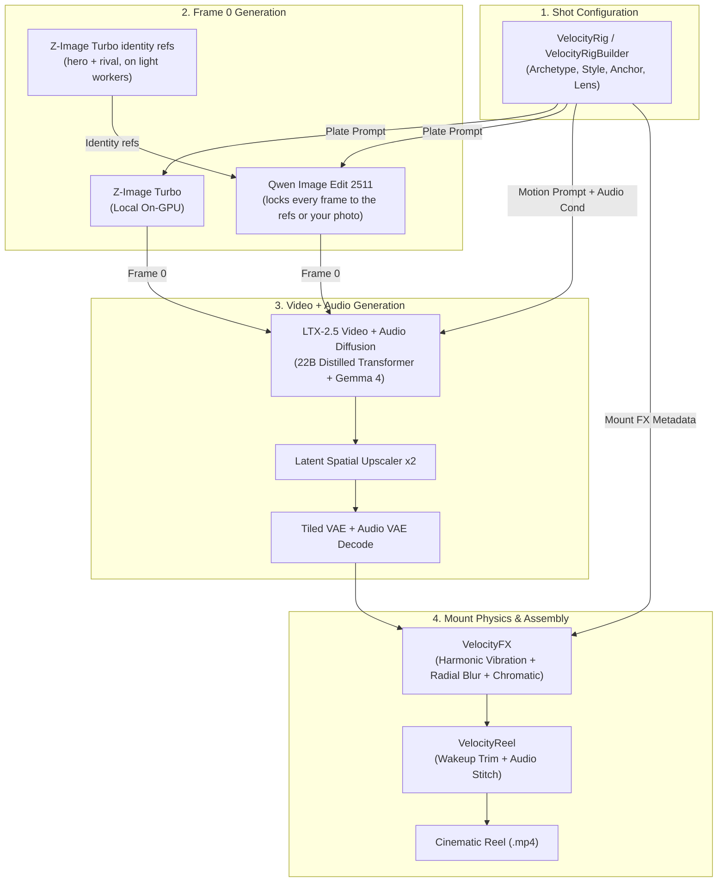

# 🏁 Velocity Rig for ComfyUI
### High-Velocity Camera Rigs, Multi-Subject Archetypes, Visual Styles & Mount Physics for LTX-2.5

[](https://github.com/comfyanonymous/ComfyUI)
[](https://huggingface.co/Lightricks/LTX-Video)
[](LICENSE)
[](https://comfy.org)

**Velocity Rig** is a complete open-source camera-rig simulation suite for ComfyUI that transforms LTX-2.5 from slow, floaty drone clips into high-energy vehicle and action-sports cinematography.

Describe a vehicle (or drop in a photo of your own), choose an archetype (**Cars**, **GP Superbikes**, **Fighter Jets**, **Downhill MTB / Action Sports**, or **Speedboats**), select an animation style (**Photoreal**, **Anime / Mountain Touge**, **3D Cartoon / Comic-Book CG**, **Synthwave Night Drive**, or **Cyberpunk**), and render high-impact 24 fps video sequences with authentic engine audio.

---

## ⚡ Why Most AI Vehicle Videos Fail (And How Velocity Rig Solves It)

1. **The Static Showroom Trap**: Standard I2V pipelines feed a parked car into the video model, forcing the diffusion process to "wake up" the car from 0 mph. This causes wheels to melt and vehicles to float.  
   👉 *Velocity Rig bakes 150+ mph motion blur, tire deformation, and road texture smearing directly onto Frame 0.*
2. **Prompt Pollution**: Generic ad pipelines bloat prompts with SaaS, legal, and brand rules.  
   👉 *Velocity Rig uses pure camera mount physics: mechanical anchors, focal lengths, camera roll, and chassis vibrations.*
3. **The Floating "UFO" Camera**: Default video diffusion floats randomly through space.  
   👉 *Velocity Rig locks the camera rigidly to the vehicle chassis (swingarms, front splitters, door panels, handlebars), forcing the camera to bank and roll with the vehicle.*
4. **Diffusion Wakeup Stutter**: The first 4–6 frames of I2V diffusion often exhibit temporal jitter as motion vectors initialize.  
   👉 *Velocity Reel automatically trims wakeup frames (`TRIM_FRAMES = 6`) and hard-cuts shots with continuous engine audio.*
5. **Optical Post-FX**: Pure diffusion lacks physical camera optics.  
   👉 *`VelocityFX` runs real-time PyTorch shaders for harmonic chassis vibration, chromatic aberration, radial speed blur, and lens distortion.*

---

## 🛠️ Included Custom Nodes

| Node | Description |
|---|---|
| **`VelocityRig`** | Pre-engineered camera rig library (39 rigs, 34 action beats, 16 worlds). Outputs calibrated first-frame prompts, LTX motion prompts, negative prompts, dimensions, seeds, and FX metadata. |
| **`VelocityRigBuilder`** | **Interactive Sandbox**: Build custom rigs by mixing and matching physical anchors, camera pitch, lens focal lengths, and mount stability for any subject archetype and style. |
| **`VelocityPlate`** | *Optional, closed partner models.* Off-GPU first frame via Codex or Nano Banana. None of the bundled workflows use it; they are open weights end to end. |
| **`VelocityFX`** | Hardware-accelerated camera-mount optics: PyTorch harmonic chassis shake, radial speed blur (keeping subject sharp), lens fringing, and crash zooms. |
| **`VelocityReel`** | Hard-cuts the last N saved shots into a continuous cinematic reel, trimming wakeup stills while preserving synchronized LTX audio. |
| **`VelocityRigList`** | Inspect and output the complete library of archetypes, rigs, styles, and action beats as structured text. |

---

## 🏎️ Multi-Subject Archetypes & Visual Styles

### 1. Subject Archetypes
- **`car`**: Formula, GT3, rally, tuner drift, hypercars, stock cars.
- **`motorcycle`**: GP prototype superbikes, island road-course racers, cafe racers, motocross.
- **`jet`**: Supersonic fighter jets, canyon trench runs, afterburner formation breaks.
- **`action_sports`**: Downhill MTB, rally raid trophy trucks, extreme freeride.
- **`speedboat`**: Offshore racing powerboats, wake carve, rooster tail aerials.

### 2. Animation & Visual Styles
- **`photoreal`**: High-end 35mm / 70mm cinema anamorphic photograph with realistic grit and lighting.
- **`anime`**: Hand-drawn mountain-pass racing anime aesthetic, cell shading, speed lines, and dynamic anime impact frames.
- **`cartoon_3d`**: Comic-book stylized 3D CG render, punchy palettes, and chromatic pop.
- **`synthwave_retro`**: 80s neon grid night-drive aesthetic, CRT scanlines, purple/cyan chrome grading.
- **`cyberpunk_anime`**: High-contrast neon night racing, holographic trails.
- **`comic_graphic_novel`**: Halftone dot printing, high-contrast black ink shadows, Frank Miller graphic novel aesthetic.

---

## 📐 Node Architecture & Dataflow



---

## 🚀 Pre-Built Workflows (in `workflows/velocity_rig/`)

1. **`velocity_rig_builder.json`** *(Recommended)*: Complete sandbox featuring the `VelocityRigBuilder` node. Configure custom anchors, pitch, lenses, and visual styles; Qwen Image Edit keeps the hero and rival identity refs locked.
2. **`velocity_rig_race.json`**: Production race workflow: preset rig, hero + rival identity refs into Qwen Image Edit 2511 (Lightning, 4 steps), then LTX-2.5 video + audio and Velocity FX. Open weights only.
3. **`velocity_rig_shot.json`**: 100% local on-GPU workflow using Z-Image Turbo for instant frame 0 generation.
4. **`velocity_rig_photo.json`**: Drops your real-world car photo into the camera rig using Qwen Image Edit.
5. **`velocity_rig_reel.json`**: Automatically batches and cuts consecutive numbered shots into an exported video reel.

---

## 📦 Installation

### Option 1: Via ComfyUI Manager
Search for `comfyui-velocity-rig` in ComfyUI Manager and click **Install**.

### Option 2: Git Clone
```bash
cd ComfyUI/custom_nodes
git clone https://github.com/jk-open/comfyui-velocity-rig.git
pip install -r comfyui-velocity-rig/requirements.txt
```

### Option 3: Comfy CLI / Registry
```bash
comfy node registry install comfyui-velocity-rig
```

---

## 🏎️ Quick Start Example (Python API / CLI)

To render a 6-shot sequence from the command line:

```bash
# Render a 6-shot superbike battle on an island road course
python -m adfield.pipelines.velocity_rig \
  --out runs/superbike \
  --subject-type motorcycle \
  --world "island road course" \
  --seed 46

# Render an Anime drift battle on a mountain pass
python -m adfield.pipelines.velocity_rig \
  --out runs/anime-drift \
  --style anime \
  --world "mountain pass" \
  --seed 86
```

---

## 📄 License & Credits
- Released under the [MIT License](LICENSE).
- Built for the **#OpenSourceHiggsfield** ComfyUI Community Competition.
